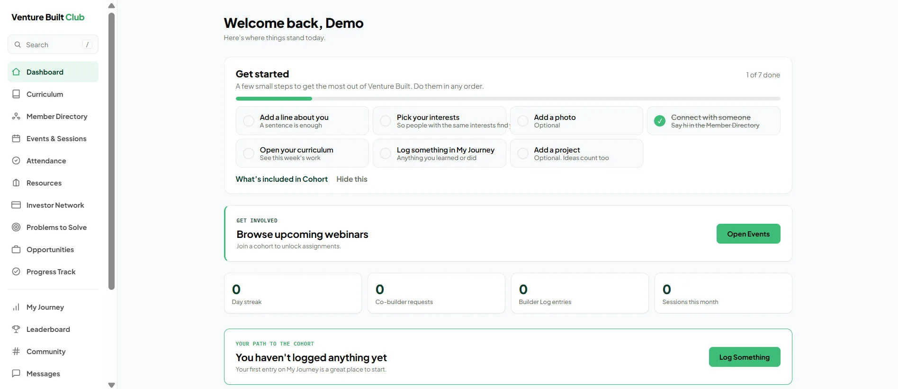

# Venture Built Club

A website for Venture Built Club at Obafemi Awolowo University (OAU), showcasing the program that turns Great Ife's most driven builders into venture-ready founders.

## Project Structure

- `index.html` - Main landing page with hero, stats, program details, FAQs, and team information

## Features

- Responsive design optimized for mobile and desktop
- Scroll reveal animations for sections
- Clean, modern aesthetic with forest green and bright accent colors
- CTA-focused layout encouraging applications and engagement

## Getting Started

Simply open `index.html` in your browser to view the website.

## Stack

- HTML5
- CSS3 (responsive, modern)
- Vanilla JavaScript (scroll reveal)
- Google Fonts (Montserrat)

## Homepage config (`site-config.js`)

The HTML ships in the safe state ("Applications opening soon") and `site-config.js` turns the live forms on. Flip states in `site-config.js`, no markup changes needed:

- `cohort.applicationsOpen` – `false`: "Applications opening soon" (disabled, no link); `true`: "Apply for the Cohort" → `/apply`
- `club.access` (`"apply"` | `"open"`) and `club.applicationsOpen` – "Apply to the Club" / "Join the Club" → `/apply/club`
- `features.whatsappFoundersCopy`, `investorIntroductionLine`, `coBuildersSpace`, `hubSharingSpace`
- `routes.founders | investors | partners | contactEmail`

## Adding the Hub screenshot

The Hub section is text-only until a real, privacy-safe screenshot is supplied. To add one:

1. Save a WebP/AVIF (under ~200 KB) as `images/hub/hub-screenshot.webp`. Replace this one file when the Hub changes.
2. In `index.html`, add `has-shot` to `<div class="hub-grid">` and insert after `.hub-copy`:

```html
<figure class="browser-frame reveal">
  <div class="browser-bar" aria-hidden="true"><span></span><span></span><span></span></div>
  
</figure>
```
